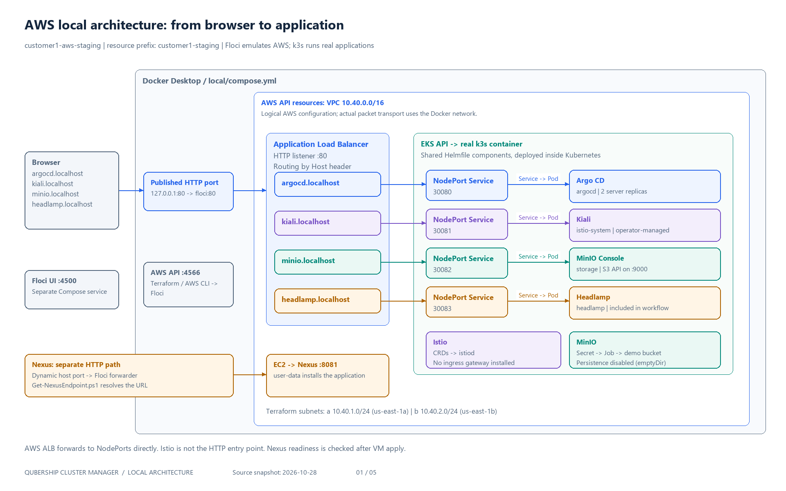

# Architecture diagrams

Open [atmos-local-demo.drawio](atmos-local-demo.drawio) in diagrams.net / draw.io using **File → Open from → Device**.
The document contains five editable pages. Nodes, labels, and connectors are editable; the pages are not flattened images.
The PNG files provide previews without a diagram editor.

## Pages

| Page | Contents | Preview |
|---|---|---|
| 01 — AWS architecture | Browser, Floci, ALB host rules, NodePorts, Kubernetes applications, and separate Nexus access | [page-01.png](page-01.png) |
| 02 — AWS workflows | Sequential infrastructure/access, parallel Nexus/platform branches, hook/no-hook readiness, and both destroy variants | [page-02.png](page-02.png) |
| 03 — Files and data | Atmos discovery, explicit imports, catalogs, stack overrides, component implementations, state outputs, and Helm values | [page-03.png](page-03.png) |
| 04 — AWS ports and access | Route files, rule priorities, health checks, security groups, Secret usage, and Headlamp RBAC | [page-04.png](page-04.png) |
| 05 — Azure local environment | Separate emulator startup, access preparation, deployment/destruction, port forwarding, and emulator limitations | [page-05.png](page-05.png) |

## Scope and source files

These diagrams describe the repository configuration as reviewed on **2026-10-28**.
They do not query live resources when opened and are not evidence that a particular environment is currently running.

The original `copy-project/docs/diagrams/atmos-local-demo.drawio` contains four pages.
This edition updates those four topics for the migrated repository and adds Azure as the fifth page.
The source project has not been modified.

| Topic | Repository sources |
|---|---|
| Discovery and stack names | [atmos.yaml](../../atmos.yaml) |
| Customer configuration | [AWS staging](../../stacks/customers/customer1/aws/staging.yaml), [Azure staging](../../stacks/customers/customer1/azure/staging.yaml), and their imported defaults/catalogs |
| Execution and deletion | [AWS workflows](../../workflows/customers/customer1/aws.yaml), [Azure workflows](../../workflows/customers/customer1/azure.yaml) |
| Nexus readiness | [Nexus catalog/hook](../../stacks/catalog/aws/nexus.yaml), [endpoint script](../../local/scripts/Get-NexusEndpoint.ps1) |
| AWS routing | [load-balancer implementation](../../components/terraform/aws/load-balancer/) |
| Shared applications | [Helmfile implementations](../../components/helmfile/), [Helmfile catalogs](../../stacks/catalog/helmfile/) |
| Emulator lifecycle | [AWS Compose](../../local/compose.yml), [Azure Compose](../../local/compose.azure.yml), [local scripts](../../local/scripts/) |

AWS VPC/subnet outlines represent API resources; local containers communicate over Docker networking.
Nexus has a dynamically published port, resolved by its endpoint script.
Headlamp is installed and removed by the current customer workflows.

Azure startup and deployment are separate operations. Start-AzureLocal does not call Prepare-AzureCluster;
the workflow calls it in the `access` step after Kubernetes apply. Its current API port is 6600;
the script discovers the published port rather than hardcoding it.
The current Floci Azure load balancer persists ARM configuration but does not forward traffic.
See the [limitations for the pinned emulator revision](https://github.com/floci-io/floci-az/blob/1edf29aded8535febe9de1067604a0a706c8ebd6/docs/services/network.md#scope-and-limitations).
The Azure destroy workflow has only been checked with dry-run in this session.
GCP has an inactive stack template and is not shown as a running deployment.

## Updating the diagrams

[build_demo_diagram.py](build_demo_diagram.py) generates the editable document and all five matching PNG previews.
It requires Python, Pillow, and the Windows Segoe UI fonts under `C:/Windows/Fonts`.
From the repository root, using a Python environment with Pillow installed:

```powershell
python ./docs/diagrams/build_demo_diagram.py
```

The generator checks node bounds, text fit, duplicate node IDs, and connector references.
Content is maintained explicitly against the source files above; it is not automatically inferred from Terraform.
Update the generator when configuration changes, regenerate, and inspect every PNG.
Manual edits to the draw.io file are overwritten by regeneration unless also reflected in the generator.


